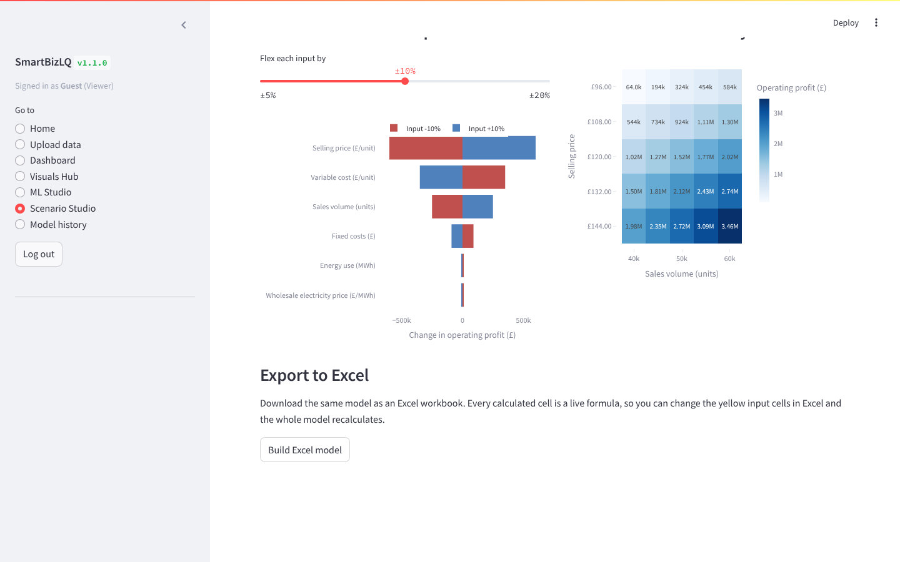
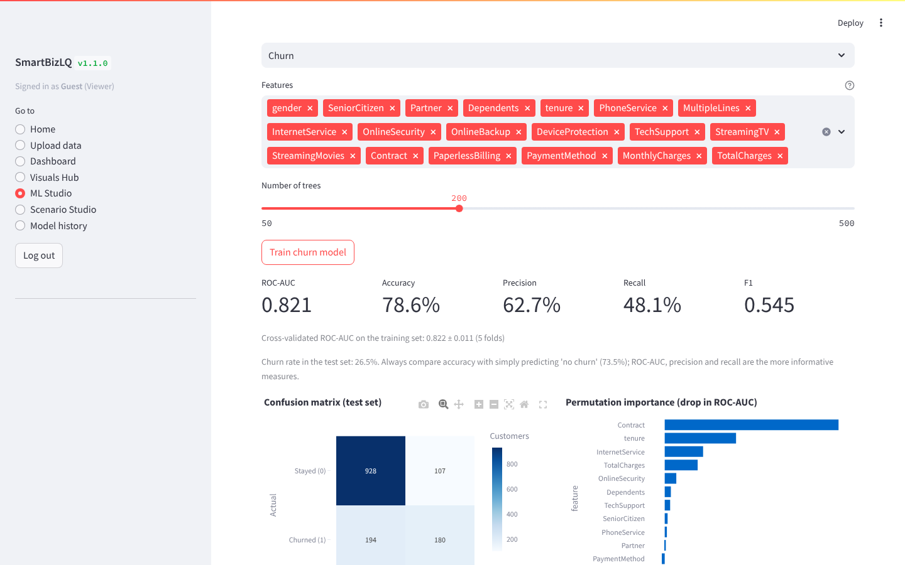
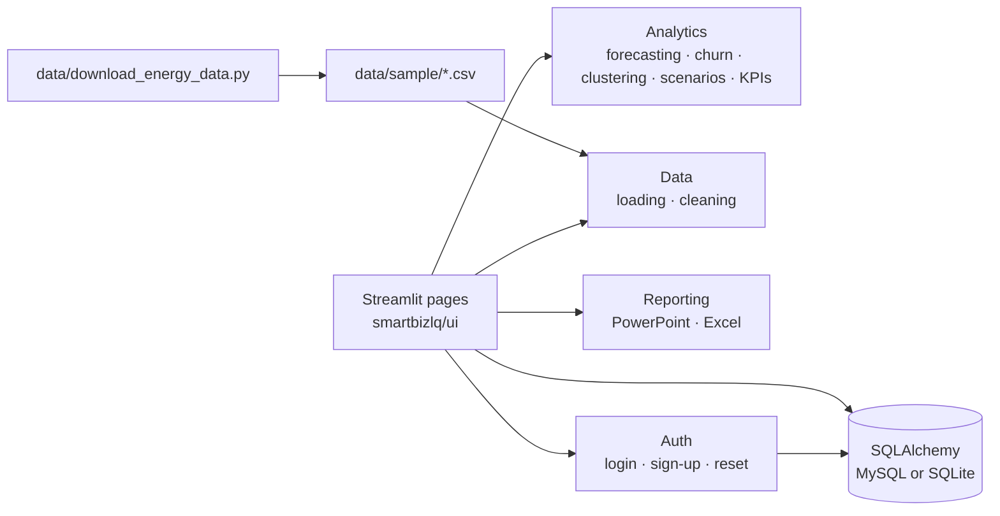

# SmartBizLQ

A self-service business analytics app built in Python and Streamlit. Users upload a CSV (or pick a bundled demo dataset), track KPIs on an interactive dashboard, build their own charts, train and evaluate forecasting, churn and segmentation models, and test commercial scenarios in a profit model that exports to Excel with live formulas.

> **Project history.** The first version was a single-file Streamlit app I built during my Data Analytics & Machine Learning internship at Networkz Systems (Jan–Aug 2025). In October 2026 I restructured it into a tested Python package and added model evaluation, the scenario and Excel module, and an energy-data pipeline. [CHANGELOG.md](CHANGELOG.md) keeps the two stages separate.



## What it does

| Area | Features |
|---|---|
| **Data** | CSV upload with delimiter detection, cleaning (blank rows/columns, duplicates, numbers stored as text), saved dataset catalogue, bundled demo datasets |
| **Dashboard** | KPI strip (revenue, orders, units, average price), date/region/category filters, revenue trend, top categories with drill-down, country map, revenue-target gauge, paginated detail table, export to PowerPoint and Excel |
| **Visuals Hub** | 24 chart types (stacked/clustered bars, combo, waterfall, funnel, treemap, pivot matrix, correlation heatmap, ...) |
| **ML Studio** | Prophet forecasting scored on a held-out period against a seasonal naive benchmark, with optional external regressors; Random Forest churn model with cross-validation, confusion matrix and permutation importance; K-Means segmentation with elbow and silhouette charts and plain-English cluster profiles |
| **Scenario Studio** | Low/Base/High cases, tornado chart, price × volume sensitivity grid, one-click Excel model where every calculated cell is a formula |
| **Platform** | Login with bcrypt-hashed passwords, Viewer/Analyst/Admin roles, emailed one-time codes for password reset, guest demo mode, MySQL with automatic SQLite fallback, model-run history |

## Results

All figures below are produced by `python scripts/evaluate_models.py`, which writes [docs/model_results.md](docs/model_results.md). Nothing here is typed in by hand.

- **Churn (IBM Telco sample, 7,043 customers):** ROC-AUC 0.821 on a stratified 20% test set (5-fold CV 0.822 ± 0.011); precision 62.7%, recall 48.1%. Contract type and tenure are the strongest drivers.
- **Segmentation (same data):** three clusters from tenure and charges (silhouette 0.452): long-tenure, high-value customers; new customers on high monthly charges; low-spend customers.
- **Forecasting (synthetic sales sample, weekly):** Prophet does **not** beat the seasonal naive benchmark (MAE 2,590 vs 2,222). The sample is about 200 randomly generated orders with no real pattern to learn, so this is the expected result, and it shows why the app always reports a benchmark.
- **Energy demand:** run the data script below, then `scripts/evaluate_models.py` adds a Northern Ireland demand forecast with temperature as a regressor.



## Quick start

Requires Python 3.10–3.13.

```bash
python -m venv .venv
# Windows
.venv\Scripts\activate
# macOS / Linux
source .venv/bin/activate

pip install -r requirements.txt
streamlit run streamlit_app.py
```

On Windows you can also double-click `run_app.bat` once the virtual environment exists.

Click **Explore as guest** to try everything on the demo data, or sign up. To create an admin account, set `ADMIN_EMAIL` in `.env` (copy `.env.example`) before registering with that address. Public sign-up can only choose Viewer or Analyst.

## Data

| File | What it is | Source and licence |
|---|---|---|
| `data/sample/smartbizlq_sample_200rows.csv` | ~200 synthetic e-commerce orders | Generated for the original project; no restrictions |
| `data/sample/telco_customer_churn.csv` | 7,043 telecom customers with churn flag | [IBM telco-customer-churn-on-icp4d](https://github.com/IBM/telco-customer-churn-on-icp4d), Apache 2.0 |
| `data/sample/ni_energy_demand.csv` (created by script) | Hourly Northern Ireland system demand + Belfast temperature and wind | Demand: [EirGrid/SONI Smart Grid Dashboard](https://www.smartgriddashboard.com) © EirGrid plc & SONI Ltd. Weather: [Open-Meteo](https://open-meteo.com) (ERA5), CC BY 4.0 |

```bash
python data/download_energy_data.py --start 2024-01-01 --end 2024-12-31
```

The demand download uses the endpoint behind EirGrid's dashboard, which is not a documented public API and may change. If it fails, download Northern Ireland demand as CSV from the Smart Grid Dashboard and run `python data/download_energy_data.py --demand-csv your_file.csv`. The script then fetches matching weather and merges the two.

Files you upload and save in the app go to `datasets/`, which is excluded from Git.

## Scenario model

A one-period profit model kept simple enough to explain line by line:

```
revenue          = price × volume
variable cost    = unit cost × volume
energy cost      = energy use (MWh) × wholesale price (£/MWh)
gross margin     = revenue − variable cost − energy cost
operating profit = gross margin − fixed costs
```

Growth scales volume and energy use; prices and fixed costs stay constant. The Excel export has four sheets: Inputs (yellow cells you can edit), Calculations (Low/Base/High columns), Outputs and Sensitivity. Every calculated cell is a formula on the Inputs sheet, and a test recalculates the workbook in LibreOffice to check it matches the Python model exactly.

## Architecture



```
streamlit_app.py           entry point
smartbizlq/
  app.py                   sign-in gate and navigation
  config.py                settings from .env
  analytics/               forecasting, churn, clustering, scenarios, kpis
  data/                    CSV reading, cleaning, dataset catalogue
  db/                      SQLAlchemy models and session (MySQL → SQLite fallback)
  auth/                    sign-up, login, password reset
  reporting/               PowerPoint and Excel exports
  ui/                      one module per page
data/                      demo data and the energy download script
scripts/evaluate_models.py regenerates docs/model_results.md
tests/                     pytest suite (66 tests)
```

## Testing

```bash
pip install -r requirements-dev.txt
ruff check .
pytest
```

GitHub Actions runs lint and tests on Python 3.10 and 3.12 for every push.

## Limitations

- Forecast regressors are held at their last observed value for future periods; a real forecast would use forecasts of the drivers (for example a temperature forecast).
- The scenario model is a single period with linear costs; it has no tax, financing or multi-year cash flow.
- The churn model is trained on a public sample dataset, not live customer data.
- Password-reset emails need SMTP settings; without them the reset flow cannot send codes.

## Future work

- Multi-year scenario model with NPV and payback.
- Wholesale price data from the all-island Single Electricity Market (SEMOpx day-ahead prices).
- Deployment on Streamlit Community Cloud with a read-only guest mode.
